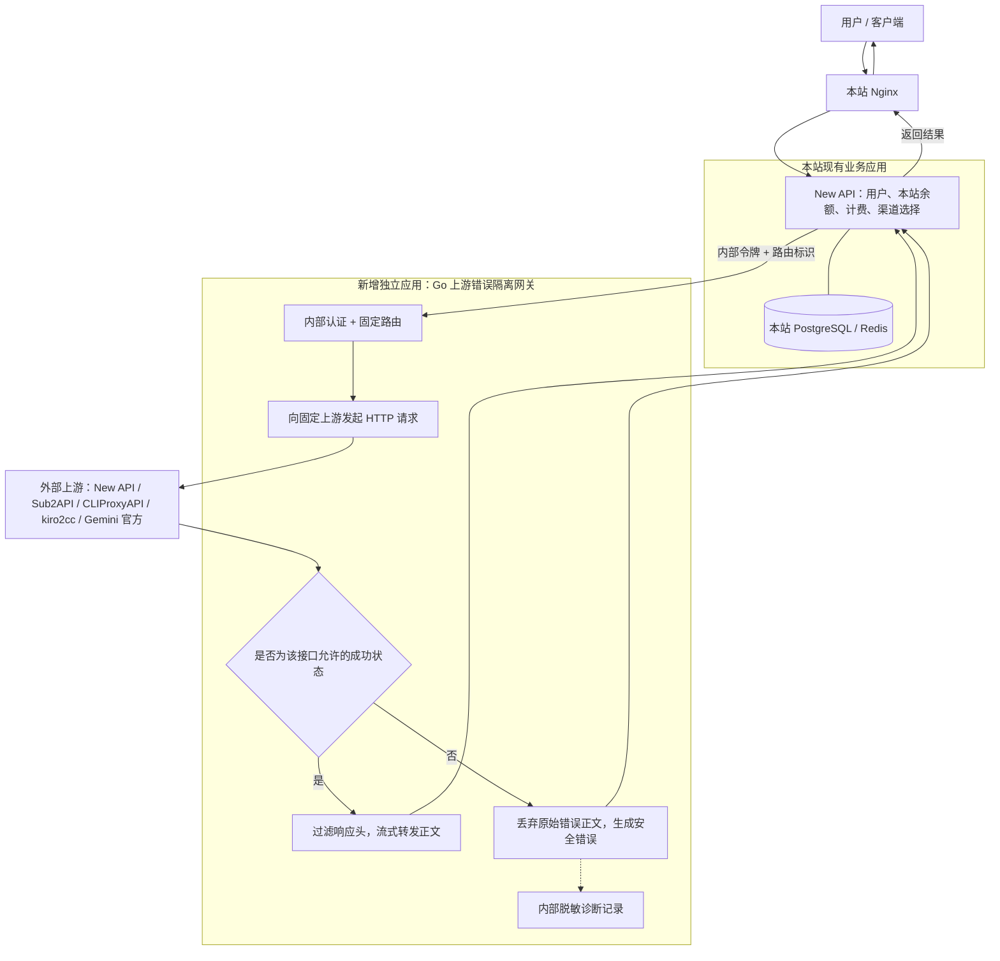

> 后续修订：数据库、完整配置版本、热更新、多协议渠道和运维页面以 [设计 v2](../../docs/design-v2.md) 为准。本文保留为历史基线。

> 接手快照：2026-11-16，从运维工作区 docs/ 复制。历史相对链接可能指向原运维目录；开发工具以本项目 .dev/README.md 为准。

# 上游网关方案：首版错误隔离与后续扩展

编写日期：2026-11-15（Asia/Shanghai）。

文档定位：本文件保留前期方案与调研记录。用户认可架构后形成的[详细设计](upstream-gateway-design.md)是后续实施基线；Windows、Linux、固定 Go 工具链和镜像构建流程见[构建环境说明](upstream-gateway-build-guide.md)。若前期配置示例或实现建议与详细设计不同，以详细设计为准。

状态：设计稿。已经核对本地固定版本源码与 Go 工具链；尚未编写网关程序、创建网关运行环境或切换业务流量。本文不代表已完成真实上游兼容、性能或安全验收。

## 1. 目标与首版边界

独立开发一个轻量 Go 服务，放在本站 New API 与上游之间，优先解决：上游通过 HTTP 错误响应返回账户余额、令牌额度、内部信息时，这些内容被继续传给本站用户。

首版按接口的成功状态转发正常响应，对其他响应统一替换错误正文，并限制上游响应头。正常 JSON 与 SSE 正文保持流式转发，不解析完整模型响应，不做协议互转。

首版包含：

- 配置驱动的固定上游路由、内部认证、上游凭证注入。
- OpenAI Chat、OpenAI Responses、Anthropic Messages、Gemini 原生生成接口的 HTTP 转发。
- 非成功响应的安全错误输出，网络失败的固定错误输出。
- 请求头、响应头、查询参数和 HTTP trailer 的明确转发规则。
- 连接复用、流式转发、取消传播、连接和并发限制。
- 请求关联、脱敏结构化日志、存活与就绪检查。

首版不包含：

- HTTP 200 正文中的业务错误识别、SSE 内部错误事件的改写、正常正文中的敏感字段清洗。这些是明确的保护缺口，不可称为“全面防泄露”。
- 用户、充值、套餐、定价、扣费、数据库或 Redis、管理后台。
- 协议互转、模型名转换、自动重试、故障切换、上游 OAuth 登录及自动刷新。
- WebSocket / Realtime、图片生成、音视频、文件上传、异步任务和任意路径代理。

后续仅在实际需要的接口或实际发现的成功响应泄露场景上扩展，避免一开始建设完整模型接入平台。多个供应商使用相同协议时共用处理逻辑，不按程序品牌复制实现。

用户进一步明确：网关需要具备扩展能力，以便后续针对酒馆空回、截断等问题增加功能。2026-11-15 核对 Spring Cloud Gateway、Spring Cloud Netflix Zuul、Kong、APISIX、Caddy、Envoy 官方设计后，采用“独立配置对象 + 按职责划分的 Go 扩展接口 + 明确处理阶段”，而不只是按目录拆文件。首版组件静态编译、配置组装；新组件需构建新镜像，不预先建设动态插件平台。用户对额外调用费用敏感，自动重试、自动续写、失败补偿不是已批准的默认方案。先定位故障，再判断能否在不增加生成调用且保持计费正确的前提下修复。调研依据见第 13 节。

## 2. Go 版本与构建基线

| 项目 | 已核对结果 |
| --- | --- |
| 本地 New API 基线 | `v1.0.0-rc.49` |
| 精确源码提交 | `48a6c87f9e7757fdc58e5be9bcb4f8281ad0dfd0` |
| New API 主模块声明 | `source/go.mod`：`go 1.26.10` |
| 项目工具链锁定 | `dev/toolchains.lock.json`：Go `1.26.10` |
| 本次实际执行 | `/opt/snewapi/dev/run go version` → `go version go1.26.10 linux/amd64` |
| 网关采用版本 | **Go 1.26.10**，与主模块和已验证工具链一致 |

参考：[版本基线](../VERSIONS.md)、[New API go.mod](../source/go.mod)、[工具链锁文件](../dev/toolchains.lock.json)、[开发环境](../dev/README.md)。New API 的独立 `relaykit` 模块声明 Go 1.25.1；网关采用主应用的 1.26.10，不以子模块的较低要求替换基线。

网关使用独立 Go module，不导入 New API 根模块，也不复制其完整依赖树。优先使用标准库 `net/http`、`net/http/httputil`、`encoding/json`、`log/slog`。首版配置采用 JSON，减少额外依赖。

未来 `go.mod` 声明 `go 1.26.10`，构建与测试设置 `GOTOOLCHAIN=local`、`GOWORK=off`，不自动下载另一个 Go 版本。沿用锁定的 Go 镜像摘要；网关需要自己的挂载目录和构建入口，现有 `dev/run` 固定挂载 New API 源码，不能直接当作网关构建脚本。

固定版本有助于复现，不表示永不升级；后续 Go 安全更新需显式评估和更新锁定。Go 适合流式 HTTP 服务，但实际延迟、内存和吞吐仍以测试为准。

## 3. 部署边界与流向



网关是独立进程、镜像和 Compose 服务。New API 继续负责渠道选择、重试、本站定价与结算，网关不访问本站业务数据库。网关异常时返回安全错误，不自动绕过网关直连上游。

第一版优先通过渠道 Base URL 和 Key 配置接入，暂不计划修改 New API 源码。能否完全零修改，以各协议接入和错误行为联调结果为准。

## 4. 路由与认证约定

### 4.1 固定路由

路由（Route）决定什么请求进入哪条处理链，上游（Upstream）保存真实连接目标。首版用路径前缀匹配组件关联两者；`/r/provider-a` 是该组件的配置，不是所有路由实现都必须遵守的硬编码规则。例如：

```text
New API 渠道 Base URL：http://upstream-gateway:8080/r/provider-a
New API 实际请求：     /r/provider-a/v1/chat/completions
网关剥离路由前缀后：   /v1/chat/completions
固定上游根地址：       https://upstream.example.invalid
最终上游 URL：         https://upstream.example.invalid/v1/chat/completions
```

上述地址仅为示例，尚无实际服务。上游根地址可包含固定部署前缀，但配置规则需避免重复拼接 `/v1`；精确结果在启动校验和集成测试中固定。

配置拆为 Route、Upstream、内部认证配置和响应处理链。Route 包含 `id`、匹配组件、`protocol`、允许的接口/方法、认证引用、选择组件和响应处理链引用；首版静态选择组件引用一个 Upstream。Upstream 保存固定根地址、上游认证方式与凭证文件、连接参数。多个路由可引用同一上游，不重复填写连接配置。上游路径由匹配结果和合法接口模板生成，不能把用户提供的任意 URL 当成目标。

一条路由绑定一种协议配置；同一供应商使用不同协议时可以建立不同路由，复用同一凭证文件。供应商名称只作为配置与内部观测信息。

### 4.2 两段凭证独立

New API 渠道里填写的是网关内部令牌，上游真实 Key 存在网关受限权限的凭证文件中。Route 引用内部认证配置；Upstream 保存出站认证配置。网关校验内部令牌后删除该凭证，再注入上游真实认证信息。首版每条路由使用独立内部认证配置，不能因多个路由引用同一 Upstream 而自动共用入站权限。

| 协议 | New API 到网关的内部令牌载体 | 网关到上游 |
| --- | --- | --- |
| OpenAI Chat / Responses | `Authorization: Bearer <内部令牌>` | 注入路由指定的上游 Bearer Key |
| Anthropic Messages | `x-api-key: <内部令牌>` | 注入上游 `x-api-key`；确有需要时配置为上游 Bearer 认证 |
| Gemini 原生 | `x-goog-api-key: <内部令牌>` | 注入上游 `x-goog-api-key` |

这是对当前适配器的接入设计，实施时必须验证 New API 的实际出站请求。路由内部令牌相互隔离；错误或跨路由令牌不能触发上游请求。不得把上游的管理密钥当作模型调用 Key。

首版不支持传入查询参数 `key` 作为内部认证；发现应拒绝，避免凭证进入 URL。Gemini 使用头部认证；`alt=sse` 等协议必要查询参数按接口允许，未知参数不盲目透传。

内部服务仅供 New API 访问，同机通过专用 Docker bridge，不发布公网端口。未来跨机时重新配置网络与 TLS，不能把同机 HTTP 通信直接扩展到公网。

### 4.3 多上游路由示例

New API 仍保存多条渠道；这些渠道指向同一个网关主机，但 Base URL 带不同路由前缀。首版路径匹配组件将前缀关联到 Route，静态选择组件再解析该路由引用的 Upstream；不从模型名猜供应商，也不依赖客户端指定目标地址。示例将前缀名称与路由 ID 设为相同以便阅读，二者在配置模型中是不同字段。

| New API 中的示例渠道 | 渠道 Base URL | 网关协议配置 | 网关保存的真实上游 |
| --- | --- | --- | --- |
| 中转站 A 的 Chat 接口 | `http://upstream-gateway:8080/r/vendor-a-chat` | `openai_chat` | `https://a.example.invalid` |
| 中转站 B 的 Messages 接口 | `http://upstream-gateway:8080/r/vendor-b-messages` | `anthropic_messages` | `https://b.example.invalid` |
| CLIProxyAPI 的 Responses 接口 | `http://upstream-gateway:8080/r/cli-responses` | `openai_responses` | 管理员配置的 CLIProxyAPI 地址 |
| kiro2cc 的 Messages 接口 | `http://upstream-gateway:8080/r/kiro-messages` | `anthropic_messages` | 管理员配置的 kiro2cc 地址 |
| Gemini 官方生成接口 | `http://upstream-gateway:8080/r/gemini-official` | `gemini` | `https://generativelanguage.googleapis.com` |

示例表示拟用的接口，并非确认各试用程序、版本和账号已经提供全部能力。New API 渠道类型必须选择与它实际向网关发出的协议相符的类型；不能因为目标变成网关，就把所有渠道统一改成 OpenAI。用户请求协议可能先被 New API 转换，路由依据是 New API 的出站协议。

以渠道 A 为例，完整处理顺序：

1. 用户使用本站 API Key 请求模型，New API 按其原有权限、分组、优先级等规则选中渠道 A。
2. New API 使用渠道 A 的网关 Base URL 与内部令牌，调用 `/r/vendor-a-chat/v1/chat/completions`。
3. 网关找到 `vendor-a-chat`，验证该路由的内部令牌、方法和协议路径。
4. 静态选择组件解析路由引用的 Upstream；网关按路径匹配结果去掉 `/r/vendor-a-chat`，使用该上游的固定根地址和对应 Key，调用 `https://a.example.invalid/v1/chat/completions`。
5. 响应沿该次 HTTP 调用返回，经过该路由的响应处理策略，再交给 New API。

同一个模型可配置在多个 New API 渠道中，由 New API 选择渠道；网关首版保持“一次入站请求对应一次应用层上游尝试”。New API 自己的重试仍可能导致多次调用，不能把“网关不重试”表述为整个系统绝无重试。

路由 ID 也是稳定的配置入口：更换真实上游地址或轮换上游 Key 时，可以只更新网关配置，保持 New API 的 Base URL 不变；新增上游通常增加网关路由和 New API 渠道。若两家需要在 New API 中独立统计、定价或切换，应使用不同路由和渠道，不能通过同一路由暗中切换来规避这些业务规则。

### 4.4 配置与升级约定

采用显式 `schema_version`，路由引用独立上游、内部认证配置和响应处理链。首版内置 `path_prefix_v1` 匹配组件、`static_v1` 上游选择组件、`route_token_v1` 内部认证组件和 `http_error_isolation_v1` 响应组件。`kind` 对应经代码注册的实现，不是脚本或任意包名。以下为更新后的拟定配置片段，仅说明字段关系，完整超时与限制字段在实现时补齐；此前文档内联上游的示例尚未实现，无运行配置需要迁移：

```json
{
  "schema_version": 1,
  "upstreams": {
    "vendor-a": {
      "base_url": "https://a.example.invalid",
      "auth": {
        "kind": "bearer_v1",
        "credential_file": "/run/secrets/vendor-a-upstream"
      }
    }
  },
  "internal_auth_profiles": {
    "vendor-a-chat-access": {
      "kind": "route_token_v1",
      "token_file": "/run/secrets/vendor-a-internal"
    }
  },
  "response_pipelines": {
    "default": [ { "kind": "http_error_isolation_v1" } ]
  },
  "routes": [
    {
      "id": "vendor-a-chat",
      "match": {
        "kind": "path_prefix_v1",
        "prefix": "/r/vendor-a-chat"
      },
      "protocol": "openai_chat",
      "internal_auth_ref": "vendor-a-chat-access",
      "select": {
        "kind": "static_v1",
        "upstream_ref": "vendor-a"
      },
      "response_pipeline_ref": "default"
    }
  ]
}
```

后续某条路由启用已实现的流式诊断组件时，可以引用含该组件的响应处理链，New API 侧地址与内部认证约定不必随之改变。新增 Go 组件需发布新镜像；切换现有组件配置首版通过受控重启生效。不存在的组件、悬空引用、未知字段、不支持的配置版本或协议与组件不兼容均在启动时失败，不静默退回透传。

请求路由与上游选择是不同扩展点：未来可开发 Host 匹配组件而保留原来的静态选择；也可在明确需求后增加受限上游池选择，而不重写协议错误处理。选择组件只能返回该路由配置授权的 Upstream 引用，不能任意生成外部 URL。首版仅静态单目标，不新增负载均衡或自动切换；这些能力会影响 New API 调度和成本，不能因接口可扩展就默认启用。

首版一条路由绑定一种协议。未来同一路由需要同时提供 Chat 和 Responses 时，可显式扩展为协议集合，按经过允许的接口路径选择处理器，并提供配置迁移与回归测试；不通过正文猜协议，不必预先实现这项功能。

## 5. 首版接口范围

| 协议配置 | 首版允许接口 | 成功状态 | 成功正文 |
| --- | --- | --- | --- |
| `openai_chat` | `POST /v1/chat/completions` | 200 | JSON / SSE 流式转发 |
| `openai_responses` | `POST /v1/responses` | 200 | JSON / SSE 流式转发 |
| `anthropic_messages` | `POST /v1/messages` | 200 | JSON / SSE 流式转发 |
| `gemini` | `POST /v1beta/models/{model}:generateContent`、`:streamGenerateContent`；需要时显式启用 `v1` 同类路径 | 200 | JSON / SSE 流式转发 |

模型路径只匹配一个合法模型段，拒绝路径穿越、编码分隔符和非预期动作。模型名由 New API 原有配置负责，不在网关改写。

非允许接口返回固定错误。例如模型发现、余额查询、token 计数、Responses compact/查询/删除、文件与任务接口不因名称相近自动放行。首版可在 New API 手工配置模型；确需模型发现等辅助能力时单独列入后续验收。

当前 New API 的部分适配器判断 `StatusCode != 200` 即进入错误处理。因此不能笼统承诺所有 2xx 都可原样返回：首版以上接口只接受 200，其他 2xx 转为安全 502。未来新接口需要 201/202 时，必须同时验证 New API 对该状态的处理。

## 6. HTTP 错误策略

错误判断主要依据状态码，不依赖“余额”“balance”等关键词。生成对外错误时，不引用上游任意文本字段，不复制上游的 `message`、`code`、`type`、`detail` 或 HTML。

| 上游结果 | 网关行为 |
| --- | --- |
| 接口允许的 200 | 筛选响应头后转发正文；不解析业务错误 |
| 400–599 | 保留 HTTP 状态码，替换为固定安全错误结构 |
| 3xx | 不跟随重定向，不转发 Location，返回安全 502 |
| 非预期 2xx / 101 协议升级 | 返回安全 502；不进入任意透传 |
| DNS、连接、TLS 失败 | 返回安全 502，不返回目标地址、原始 Go 错误或证书详情 |
| 建连后等待响应头超时 | 返回安全 504 |
| 网关并发达到上限 | 不请求上游，返回固定 503 |
| 内部认证失败 / 路由不存在 | 返回固定 401 / 404，不请求上游 |

HTTP 临时响应 1xx（尤其 103）不得绕过响应头规则转发。实现需要显式控制 `ReverseProxy` 的临时响应处理，不能只过滤最终响应。

按协议生成最小安全错误结构：OpenAI Chat / Responses 使用 `error.message/type/code`；Anthropic 使用 `type: error` 和 `error.type/message`；Gemini 使用 `error.code/message/status`。所有文本与枚举由网关生成，错误中的 HTTP 数字码与外层一致。对于协议没有精确对应枚举的状态，使用该协议支持的通用错误类型，不复制上游枚举凑格式。

例如 OpenAI 风格上游 403 的安全输出：

```json
{
  "error": {
    "message": "Upstream request failed. Reference: gw_example",
    "type": "upstream_error",
    "code": "upstream_http_403"
  }
}
```

请求编号由网关生成，不含供应商名称、路由名称或账号。网关 ID 可以进入固定错误文本，避免 New API 丢弃自定义响应字段后无法关联。New API 仍保留其自己的请求编号。

仅凭 403 不能认定余额不足，仅凭 429 不能认定临时限流；首版不伪造更具体的诊断。保留状态码也不等于完整保持 New API 行为：其部分禁用/重试逻辑依赖错误文本或 code，需要联调验证。不得通过恢复原文来解决兼容问题，可调整安全码映射或 New API 策略。

## 7. 正常转发与头部规则

请求正文不做 JSON 重序列化；成功正文不做全量读取或业务字段重写。这样保留工具调用、缓存用量、推理 token 和响应内容。网关不计算 token，也不改计费字段。

请求头按协议允许：内容类型、Accept，以及经确认需要的 `anthropic-version` / `anthropic-beta` 等。Host、认证头和内部请求关联由网关控制；客户端 Cookie、转发链、未知自定义头不自动发往上游。只允许当前支持的 JSON 请求媒体类型并限制请求体大小。

成功响应头初始允许：经校验的 `Content-Type` 和必要的 `Content-Encoding`。非必需的上游服务器信息、账号信息、限额字段、Cookie、CORS 和上游请求 ID 不转发。协议专用头按验证结果显式扩充，不使用 `X-*` 整类放行。

错误响应重新设置 JSON Content-Type、内容长度与 `Cache-Control: no-store`，清除原始压缩、长度、ETag、Location 和 trailer。`Retry-After` 只在相应状态上解析、限界并规范化后允许，不把任意上游字符串直接返回。

响应 trailer 默认丢弃，包含响应体结束后才出现的 trailer；仅删除初始 `Trailer` 头不足以覆盖所有实现路径。Hop-by-hop 头和 Connection 指定的头按 HTTP 规则移除。

压缩策略：出站 Transport 禁用隐式自动解压，首版不主动协商压缩；如果上游仍返回受支持的压缩成功正文，则保持压缩字节与 Content-Encoding 匹配。未知编码返回安全错误。错误正文不依赖解压或解析即可丢弃。

首版不会阻止 HTTP 200 正文或流式事件内的余额文本泄露。如果真实上游存在这种行为，记录为不满足当前保护目标，增加有针对性的处理后再纳入受保护接入范围。

## 8. Go 实现与性能设计

以标准库 `httputil.ReverseProxy` 的 `Rewrite`、`ModifyResponse` 和 `ErrorHandler` 为候选基础；必须补齐临时响应与 trailer 策略。如标准行为无法满足，使用受控 `Transport.RoundTrip` 转发循环，仍避免自行实现 HTTP 协议栈。

- 共享并复用 `http.Transport`，按上游控制连接数与空闲连接。不会为每次请求新建连接池。
- 使用固定大小复制缓冲区和有限并发，内存不随完整响应大小线性增长。不为每段数据新增无界队列或 goroutine。
- SSE 数据到达后及时刷新；不等待整个响应完成。不靠解析完整事件才能转发。
- 客户端取消传递到出站请求并及时关闭响应体。上游流中断不伪造成功结束标记，不自动重放请求。
- 若已经发送 200 响应头，后续读取失败不能再改为 502，也不能追加随意格式的 JSON；终止流并写内部错误记录。
- 网关不做业务重试，不引入请求正文重放。确认 Transport 不会因幂等标记对生成请求产生非预期重试；幂等键如需支持，另行明确策略并验证。
- 分别配置连接、TLS 握手、响应头等待、流空闲和下游写入超时。避免统一短 `http.Client.Timeout` 或全局短 WriteTimeout 截断正常长流；必要的总时长限制按路由配置。
- 限制请求体、请求头、并发连接、诊断采样和日志体积；配置值以本机及目标机测试确定。
- 健康检查只检查进程和配置状态，不自动调用付费模型。无公开 pprof、配置或诊断接口。

配置启动时严格校验：重复路由、缺失凭证、未知协议、非法 URL、矛盾的超时限制等直接失败；不打印完整配置。第一版配置变更通过受控重启生效，不增加热更新控制面。

上游仅使用管理员配置的固定目的地址，不接收运行时任意 URL，拒绝重定向。允许访问同机试用上游时显式列入目的地配置，不能简单禁止全部内网，也不能允许访问 Docker socket、云元数据或任意本机端口。公网 HTTPS 必须校验证书，不以跳过 TLS 校验处理国内网络问题。

### 8.1 扩展边界：保持连接基础设施与响应处理分开

在同一个 Go 进程里划分以下职责，不拆成多个微服务，不使用 Go 动态 plugin 或脚本运行时：

| 模块职责 | 首版实现 | 后续空回、截断能力涉及的变化 |
| --- | --- | --- |
| 配置对象、匹配与选择组件 | Route/Upstream 引用、路径匹配、静态选择 | 增加匹配或选择实现，保持已有路由兼容 |
| 入站与出站认证组件 | 路由权限、内部令牌、上游凭证注入 | 根据实际认证方式增加实现，不修改响应策略 |
| HTTP 传输 | 连接复用、一次尝试、取消、限流、超时 | 针对实测问题调整，作为所有协议的公共基础 |
| 协议描述与错误编码 | 合法路径、媒体类型、安全错误结构 | 增加 JSON / SSE 事件解析和结束原因识别 |
| 响应处理策略 | 状态拦截、头部过滤、成功正文复制 | 新增协议观察器；必要时新增受控事件改写模式 |
| 诊断与请求生命周期 | ID、状态、时间、字节数、结束原因 | 增加正文/推理/工具事件数量、终止标记、缺失用量等元数据 |

响应策略在写出响应头之前被选择；统一出口负责提交头部、串行写入数据、Flush、结束和取消。不要让各模块随意直接操作 `ResponseWriter`，否则以后无法可靠判断是否还能改状态、是否已交付数据。

生命周期需要区分：等待上游响应头、已收到上游状态、下游响应头已提交、正文转发中、已结束/取消。首版只知道“写过字节”，不能将其等同于“已经输出有效正文”；后续协议观察器才能进一步判断角色声明、推理、工具调用与文本内容。

内部响应处理可以逐步形成三种模式：

1. **转发模式（首版）**：不理解成功正文，直接有界复制；只执行公共错误与头部规则。
2. **观察模式（后续）**：保持交付字节和顺序，使用有界增量解析器观察事件，记录是否有正文、结束原因和用量事件；不因诊断主动再次调用模型。解析失败或超出观察限制时标为“未知”，不能断言空回或正常完成；传输错误仍按传输失败处理。
3. **受控处理模式（按实际需求开发）**：只在明确协议和已复现问题上修复事件封装、增加允许的心跳或安全错误事件；启用前验证正文、结束语义和完整计费用量。用于安全拦截的处理器遇到未知格式不能悄悄绕过安全规则，需要按未提交/已提交状态安全失败。

观察模式的有界解析需要正确处理事件跨网络分块、UTF-8 跨分块、多行 SSE data、大小限制与压缩；不能简单逐 TCP chunk 解析 JSON。不为“观察”保存整篇聊天，不让诊断分支形成无界缓存。首版不实现这些未来解析器，仅保留单独的响应处理边界和生命周期状态。

扩展能力意味着局部增加实现并重新构建镜像，不意味着后续功能只改配置就能自动出现。目标是无需重写路由、认证、连接池、部署和 New API 渠道地址；协议处理、内存预算和端到端兼容仍需按新增能力测试。

组件契约不能只有一个通用 `Handle(any)`：匹配、选择、认证、响应头处理、字节观察、协议事件观察分别使用小接口，只实现所需能力。Go 组件按类型注册名称和构造函数，配置加载时完成严格解析、引用校验、资源初始化与清理；初始化失败回收已分配资源。共享组件配置不可变，请求状态按请求单独分配，不把解析缓存放进跨请求共享实例。

处理顺序明确固定为：匹配路由 → 内部认证与接口校验 → 选择已授权上游 → 路径构造和上游认证 → HTTP 传输 → 响应头阶段 → 响应体阶段 → 结束诊断。不同阶段不靠任意数字优先级混排。响应处理链在各自阶段按配置顺序执行，由启动校验保证必要依赖；头部清理与错误隔离等必需能力不得被空链或关闭观察组件一起移除。

扩展阶段的含义必须写进接口契约：响应头阶段发生在向 New API 提交响应头之前，允许拒绝或替换；响应体阶段逐块或逐协议事件运行，不要求完整缓存；结束诊断阶段只记录最终状态并释放资源，不能在输出完成后才尝试改状态或正文。核心保证结束诊断对每个已创建请求上下文执行一次，包括错误与取消。不要将这些阶段统一为“拿到完整 body 后调用插件”，否则首版即破坏流式体验。全局必需组件与路由可选组件分开，配置编译后形成确定的执行链，不引入复杂的多层覆盖优先级。

区分只读观察与改写权限：观察器不能自行重试、修改 URL/认证/usage 或直接写客户端。统一转发循环只读取一次上游 body，并将有界片段或事件分发给组件，避免多个组件争抢同一流。协议解析按需使用，每条流只建一次所需解析器；未知格式的诊断退化与安全处理失败的行为分别规定。SSE 完整事件不等于一次网络读取块，也不等于 HTTP/2 frame。

首版不用动态 `.so`、Wasm、脚本或独立 gRPC 插件进程；“组件静态编译”与“配置决定启用和组合”可以同时成立。只有确实需要不重建发布或第三方扩展隔离时，再评估独立插件执行方式。新处理链默认只在指定路由灰度，回退时恢复旧链但保留基础错误隔离。

### 8.2 后续空回与截断的实施路径

1. **先观察**：在少量路由开启对应协议的诊断，区分正常完成、长度上限、拒绝、仅推理、合法工具调用、没有有效内容、缺少结束标记、网络中断和客户端取消。流成功与 HTTP 成功分开记录，不改变正常回答或发起额外生成。
2. **定位边界**：比较上游到网关、网关到 New API、New API 到酒馆各段行为。网关位于 New API 后面，无法独自识别客户端正则隐藏、New API 转换丢失等所有问题；不能以网关收到完整响应证明用户已收到完整回答。
3. **修复已证实的传输问题**：及时 Flush、合理超时、取消传播、不提前关闭末尾用量事件；协议封装问题在对应处理器内有针对性修复。客户端主动取消时不为了等待 usage 而继续生成。
4. **按需增加保活**：网关发出的心跳能否穿过 New API 到达酒馆必须端到端验证。首版等待上游响应头期间不提前发 200 心跳，否则会破坏 HTTP 错误状态隔离；若未来需要改变这一行为，必须设计流式错误映射并单独验收。收到上游 200 后的心跳也不能无限延长上游无进展的等待。
5. **保留能力边界**：上游未生成正文或已经停止生成时，网关不能凭空恢复内容；自动续写和重试均不是默认解决方案。协议观察或错误改写可能触发 New API 自身重试，扩展验收必须同时检查这一影响。

不以工具调用或推理阶段暂时没有文本判为空回；不把错误提示伪装成 assistant 正文；不修改结束原因为正常成功；不丢弃或拼造 `usage`、`billing_usage`、缓存和推理明细。上游缺少用量时保留真实状态，不把估算冒充原始统计。

每次增加会影响响应的处理，都用固定上游样本做“直连 New API”和“经过网关”的交付与扣费对照。成功转发应保持一致；异常场景若有有意改变，明确记录 New API 的重试、预扣、结算或退款行为，不能承诺独立网关天然保证账目正确。

## 9. 日志与运维

默认结构化日志记录：网关请求 ID、内部路由 ID、协议、HTTP 状态、耗时、字节数、取消/超时类别。只记录路径模板，不记录完整 URL 查询参数、认证头、Cookie、请求正文或正常响应正文。

默认不保存上游原始错误正文。这样避免把原有泄露搬到普通容器日志中。排查确实需要时，按路由短时开启受控错误采样：最多读取 16 KiB，受读取时限约束；超过限制或无法完成脱敏时丢弃样本，仅保留元数据。

采样写入独立、访问受限且有容量/留存限制的诊断文件，禁止进入用户日志。正文可能包含任意凭证，字符串脱敏不能保证覆盖一切；诊断文件始终按敏感数据管理。关闭采样不能影响错误替换功能，采样也不能无限阻塞用户错误返回。

内部令牌、上游 Key、配置密钥引用及诊断文件不进入 Git。未来配置与凭证需增加独立加密备份；现有 New API 三项目备份脚本不会自动包含新网关文件。

## 10. 开发目录与部署建议

建议后续在 `/opt/snewapi/gateway/` 创建独立 Go 模块（本次仅写方案，未创建）：

```text
gateway/
  cmd/gateway/          启动入口
  internal/config/     配置与启动校验
  internal/proxy/      请求编排、传输与统一写入出口
  internal/routing/    Route/Upstream、匹配和选择组件
  internal/auth/       入站与出站认证组件
  internal/component/  类型化注册、构造与生命周期契约
  internal/policy/     响应策略；首版错误隔离，后续增加观察或处理模式
  internal/protocol/   路径匹配与错误编码；后续按需加入事件解析
  internal/observe/    关联编号与诊断记录
  go.mod
  config.example.json  无秘密的配置示例
  deploy/              后续独立构建和运行模板
```

网关独立构建成带版本和提交标识的镜像，固定镜像摘要，目标机只拉镜像运行，不要求安装 Go 或 Buildx。首版不需要把 New API 完整代码复制到网关，也不要求创建远程仓库。

目标部署可使用独立 Compose 项目及仅连接 New API 与网关的网络；网关仍需访问外部上游，不能误用完全禁止出站的网络模式。没有公网监听入口。若网关同机额外部署，候选容器上限为 **128 MiB，仅作为待测试起点**。

现有四服务容器内存上限合计 1600 MiB，增加 128 MiB 后为 1728 MiB；2 GiB 主机剩余名义空间约 320 MiB，还要容纳宿主机、Docker 和其他进程。这不构成容量验收，必要时调整现有预算或单独部署网关，不应直接套用该上限上线。

生产配置切换前先在隔离开发环境使用独立令牌和模拟上游。当前工具连接国内服务器，不代表已在 Vultr 执行。真实海外模型和固定摘要镜像拉取必须在实际目标网络验证，下载保留有限超时/重试及校验。

## 11. 验收计划

以下均为待执行测试，不是已通过结果。

| 范围 | 关键验收条件 |
| --- | --- |
| 非成功响应隔离 | 400/401/402/403/429/500/502/503/504 及自定义错误状态；正文放入虚构余额、Key、URL，输出中不得出现这些标记；原文为 JSON/HTML/纯文本/压缩/空正文均可拦截 |
| 状态边界 | 3xx 不跟随且不转发 Location；101 不升级；非预期 201/202/204 返回固定安全错误；临时 1xx 不能泄露响应头 |
| 头部和 trailer | 余额头、Set-Cookie、未知限额头、Connection 指定头、结束时才出现的 trailer 不泄露；正文替换后长度/编码正确 |
| 正常响应 | 各协议 JSON 正文内容保持一致；工具调用、usage、缓存与推理用量不变；响应头删减不破坏 New API 解析 |
| 流式响应 | 首段及时到达；持续流不被短总超时误杀；慢客户端有界；取消关闭上游；中途断流不伪造成功、不重试、不泄露内部网络错误 |
| 已知保护缺口 | 200 内嵌错误和 SSE 错误事件仍按首版策略转发，明确记录缺口；不得将这些用例计入“余额全面隔离通过” |
| 路由与认证 | 缺失/错误/跨路由令牌、路径穿越、未知方法和查询认证参数不触发上游；内部令牌不外传，出站凭证正确 |
| 多路由隔离与配置演进 | 相同模型经不同路由到达各自固定目标与凭证；共享 Upstream 不共享入站权限；更换真实目标不改变 New API Base URL；未知组件/配置版本/悬空引用启动失败，不能回退为无保护透传 |
| 扩展契约 | 路径按段匹配、歧义路由拒绝；只允许选择授权上游；响应阶段顺序固定；移除观察器不移除错误隔离；共享组件无请求状态串扰；初始化失败释放资源 |
| New API 联调 | 四类协议经网关往返；本地余额不足提示不变；上游错误在用户日志中无原文；请求编号可关联；错误码替换后的重试/禁用行为明确 |
| 计费联调 | 对成功、失败、取消、断流分别确认 New API 原有预扣/结算/退款行为；网关不添加重试导致重复调用，usage 不改变 |
| 资源测试 | 对比直连与经网关的非流式和长流请求，记录硬件、并发、响应大小、首字节延迟、额外延迟、RSS、CPU、文件描述符及取消后资源回收 |
| 真实上游 | New API、Sub2API、CLIProxyAPI、kiro2cc、Gemini 官方按实际版本与已用接口逐项验证，不因品牌或“兼容”声明而自动通过 |

测试优先使用 Go `httptest` 和受控模拟响应；不为验证余额不足去耗尽真实账户。真实上游可用隔离测试凭证验证允许的失败场景。HTTP 200 业务错误与流式错误若在目标上游实测出现，必须明确当前限制或扩展实现后再认定该上游受到所需保护。

性能测试关注有代表性的并发与长流，不预设“百万并发”或固定延迟承诺。测试、构建和部署分别留档；通过模拟不代表真实上游和 2 GiB 宿主机已验收。

## 12. 实施顺序与回退

1. 确认实际首版路径和协议清单，记录各路由的固定目的地及所需认证方式；不需要为此收集或公开生产密钥。
2. 建立独立 Go 1.26.10 模块与固定工具链构建入口，实现最小认证、固定路由、200 转发和错误替换。
3. 补齐头部/trailer/临时响应、超时、取消、日志及资源限制，完成模拟验收。
4. 在独立 New API 开发环境联调，检查错误解析、重试、渠道禁用、用户日志与计费；必要时再做最小兼容调整。
5. 在真实目标网络验证已使用的上游接口和资源预算，先切一个测试渠道，再逐步扩大。
6. 发布记录绑定网关源码提交、Go 版本、镜像摘要、配置版本、通过范围及未覆盖项。

切换前保存每个渠道原来的 Base URL、Key 与策略到受保护备份。优先回退网关上一版镜像和配置；回退为 New API 直连上游会重新暴露此前的错误正文风险，必须作为明确的人工操作，不能作为自动容灾路径。未确认安全回退时可以暂时停用受影响渠道。

本次仅形成方案并确认工具链，未修改 New API、运行配置或生产数据。

扩展阶段另行验收：关闭新策略时基线响应行为一致；开启观察时交付字节与用量不变；只对选定路由启用新能力；解析内存有界；观察失败可识别；心跳和流内错误可被实际 New API/酒馆处理；不增加未经设计的模型调用或引入隐式重试。

## 13. 成熟网关扩展机制调研与取舍

核对日期：2026-11-15。下列结论来自本次成功读取的官方文档，是架构参考，不是对这些产品进行部署、压测或锁定版本的结果。在线文档可能继续更新；Spring Cloud Netflix Zuul 明确引用历史版本文档，不与新版 Netflix Zuul 混为一谈。

### 13.1 已核对的设计

| 产品 | 官方扩展机制 | 对本项目的启发 |
| --- | --- | --- |
| Spring Cloud Gateway Server WebFlux | Route 匹配后进入过滤链；自定义 `RoutePredicateFactory` 和 `GatewayFilterFactory`；全局与路由过滤器合并，`Ordered` 决定次序，pre/post 顺序相反 | 路由条件本身可扩展；请求处理与路由定义分开；明确前后阶段及执行顺序，不能只拆包 |
| Spring Cloud Netflix Zuul（2.2.10.RELEASE 文档） | `ZuulFilter` 提供 `filterType`、`filterOrder`、`shouldFilter`、`run`，有 pre、route、post、error 等阶段；Spring Bean 集成自定义过滤器 | “转发到哪里/怎样转发”也可以扩展；过滤器应声明阶段与适用条件。该历史文档列出 Zuul 为 maintenance mode 模块，只借鉴模式，不作为当前 Go 项目的运行底座 |
| Kong Gateway | Route 匹配请求并关联 Gateway Service；Upstream/Target 表达上游池与实例；插件在 access、header_filter、body_filter、log 等阶段运行，可按实体范围配置 | 路由对象不应装下所有上游细节；响应头、响应体与日志分别扩展；支持按路由开启功能 |
| Apache APISIX | Route 可引用 Service 与 Upstream；插件有配置 schema 和阶段函数；同阶段由 priority 排序 | 独立上游引用减少重复配置；扩展配置要校验，执行顺序要确定 |
| Caddy | Go 模块注册名称、构造函数和职责接口；模块经加载、配置、Provision、Validate、Cleanup 等生命周期；自定义模块可静态编译进二进制 | 最贴近 Go 单进程实现：注册组件、配置启用、类型化接口、资源生命周期；可扩展不等于必须动态加载代码 |
| Envoy | HTTP decoder/encoder filters 分别处理请求/响应头、body、trailers；链顺序明确，响应方向逆序；ext_proc 可用双向 gRPC 扩展 | 必须明确流生命周期和背压；外部插件是一种独立执行方案，有额外进程、通信与故障处理，不应首版默认引入 |

参考链接（本次实际读取）：

- Spring Cloud Gateway：[How It Works](https://docs.spring.io/spring-cloud-gateway/reference/spring-cloud-gateway-server-webflux/how-it-works.html)、[Developer Guide](https://docs.spring.io/spring-cloud-gateway/reference/spring-cloud-gateway-server-webflux/developer-guide.html)、[Global Filters](https://docs.spring.io/spring-cloud-gateway/reference/spring-cloud-gateway-server-webflux/global-filters.html)。
- Spring Cloud Netflix：[2.2.10.RELEASE Reference](https://docs.spring.io/spring-cloud-netflix/docs/2.2.10.RELEASE/reference/html/)，重点为 Zuul 开发过滤器与 Modules In Maintenance Mode 部分。
- Kong：[Gateway Entities](https://developer.konghq.com/gateway/entities/)、[Plugin Handler](https://developer.konghq.com/custom-plugins/handler.lua/)、[Plugin Scopes and Order](https://developer.konghq.com/gateway/entities/plugin/)。
- APISIX：[Route](https://apisix.apache.org/docs/apisix/terminology/route/)、[Service](https://apisix.apache.org/docs/apisix/terminology/service/)、[Upstream](https://apisix.apache.org/docs/apisix/terminology/upstream/)、[Plugin Development](https://apisix.apache.org/docs/apisix/plugin-develop/)。
- Caddy：[Extending Caddy](https://caddyserver.com/docs/extending-caddy)、[Architecture](https://caddyserver.com/docs/architecture)。
- Envoy：[HTTP Filters](https://www.envoyproxy.io/docs/envoy/latest/intro/arch_overview/http/http_filters)、[External Processing](https://www.envoyproxy.io/docs/envoy/latest/configuration/http/http_filters/ext_proc_filter)。

### 13.2 对本项目特别重要的发现

Kong 的 `response` 钩子在完整上游响应到齐后、发送给客户端前运行，会自动启用 buffered proxy；`header_filter` 与 `body_filter` 则分别处理头部与逐块响应。官方文档还说明 `response` 不能与这两类钩子同时实现。这里最值得借鉴的是完整响应处理与流式处理必须明确区分，不能简单照搬一个“后处理插件”概念。我们的流式组件采用逐块/逐事件能力声明，首版不支持依赖全量缓冲的插件。

APISIX Route 文档直接指出：将重复的插件与上游配置内联在每条 Route 会增加维护成本，因此独立抽象 Service 和 Upstream。我们据此将此前示例的 `upstream_base_url` 和上游认证从 Route 中移到可引用 Upstream。首版没有进一步引入 Service 层，因为尚无需要它解决的独立复用问题；共享响应链已经覆盖当前策略复用。

Spring Cloud Gateway 的 post 阶段、Envoy 的响应过滤方向和 Kong 的阶段回调不是同一套调用语义。我们借鉴“顺序明确”这一要求，不把它们拼成含糊的通用中间件：核心维护命名阶段，每个阶段按声明顺序执行，结束诊断不拥有已经输出的响应修改权。

### 13.3 本次设计修订

1. 将路由匹配与上游选择分别作为组件：首版 `path_prefix_v1` + `static_v1`。未来可开发 Host 匹配或受限上游池选择，原错误处理组件无需改写。
2. 将 Route 与 Upstream 分离，路由再引用内部认证配置和响应链。固定 URL 前缀只是默认匹配规则，不是网关内核唯一的路由机制。
3. 使用 Go 静态组件注册与构造，按职责定义小接口，明确配置校验、初始化、请求状态和清理。首版不做第三方插件上传或运行时下载。
4. 将响应扩展分为提交前头部处理、流数据处理、终止诊断；原始字节观察与协议事件观察分开，增量解析按需开发。
5. 保留全局必需的错误隔离和头部规则；可选诊断按路由开启。未知组件、歧义路由、悬空引用、无法满足的依赖在启动时拒绝。

示意调用链：

```text
New API 请求
  → 路由匹配组件：选择 Route
  → 内部认证组件：校验该 Route 权限
  → 上游选择组件：解析授权的 Upstream 引用
  → 出站认证组件：注入该 Upstream 的凭证
  → 公共 HTTP Transport：发起请求
  → 响应头阶段：HTTP 错误隔离、头部筛选
  → 响应体阶段：首版有界复制；后续可增加事件观察/处理
  → 终止阶段：完成、失败、取消的诊断与清理
```

### 13.4 自研与复用成熟网关的边界

上述调研不能直接证明“自研一定比 Caddy/Kong 等更好”。若目标只是通用路由和响应头改写，复用现有产品值得考虑；本项目还要求 Go 开发、轻量部署、后续协议事件诊断与 New API 用量兼容，因此当前建议仍是独立 Go 网关，参考其扩展模型，复用 Go 标准 HTTP 实现。

基于 Caddy 定制 Go 模块也是可比较的实现路线，但需要验证其响应流钩子、体积与资源预算、Go 版本约束和首版错误隔离需求；本次没有做这项原型验证，不能断言已兼容或已优于独立程序。Kong/APISIX/Envoy 的现成插件是否足以覆盖本项目也未实测。不因调研自动引入 JVM、Lua/OpenResty、etcd、gRPC 插件进程或新运行栈，不改动已经确认的 Go 1.26.10 基线。
