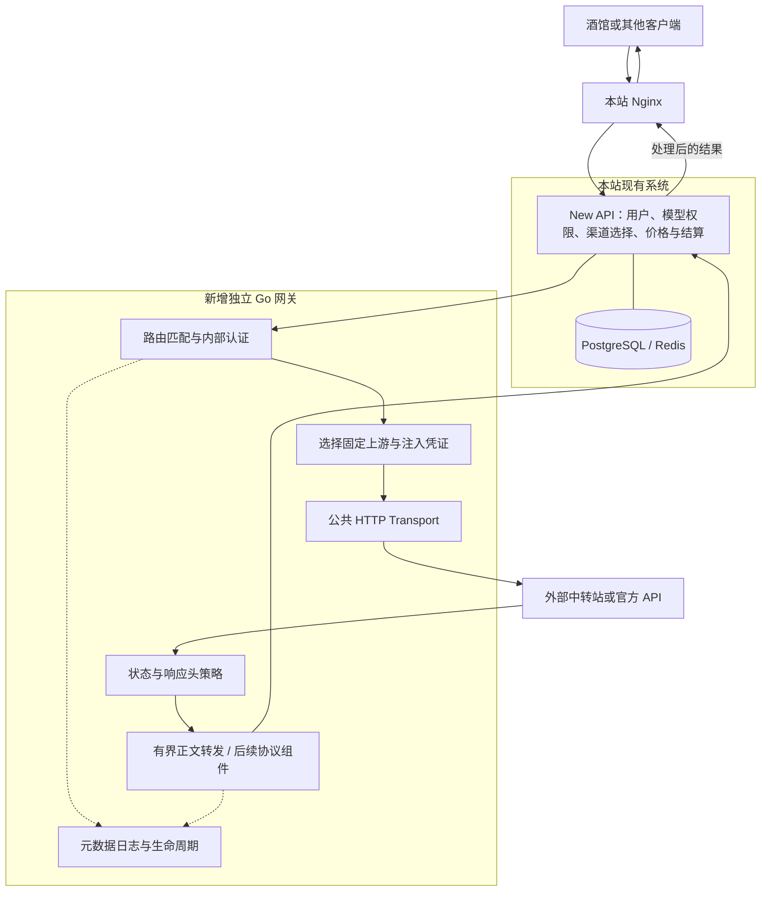
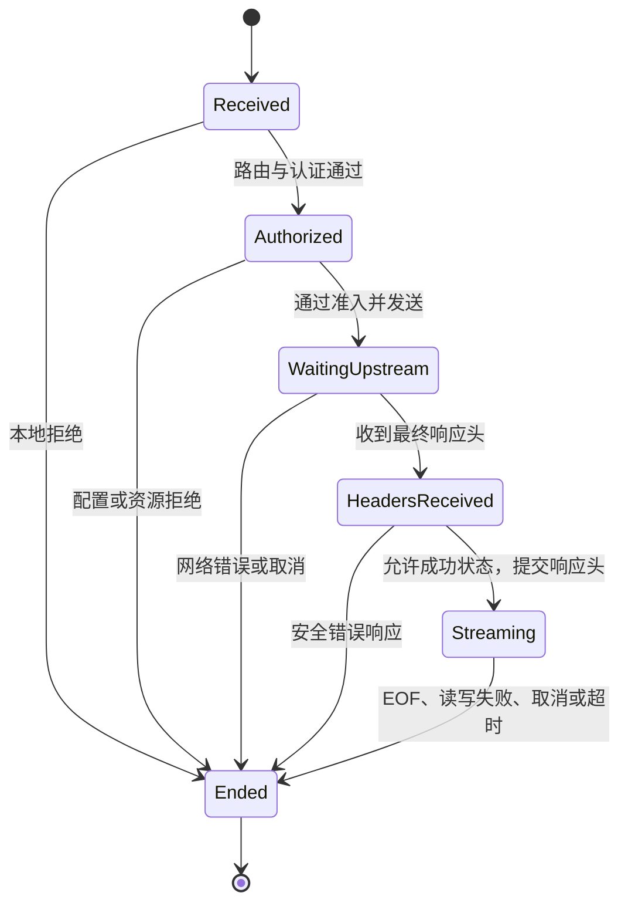

> 接手快照：2026-11-16，从运维工作区 docs/ 复制。历史相对链接可能指向原运维目录；开发工具以本项目 .dev/README.md 为准。

# 上游网关详细设计

版本：设计基线 v1.0；日期：2026-11-15（Asia/Shanghai）。

本文将已讨论并认可的架构整理为实施契约。状态为**设计完成、发布验证骨架已实现、网关业务待实现与验收**，不是已经完成业务转发的软件说明。开发语言固定 Go 1.26.10。构建与 Windows 开发环境见[构建环境说明](upstream-gateway-build-guide.md)；发布骨架与流水线见[GitHub Actions 发布说明](gateway-ci-publishing.md)；调研过程和官方资料见[前期方案第 13 节](upstream-error-gateway-plan.md#13-成熟网关扩展机制调研与取舍)。后续业务实施以本文为准，前期方案保留为背景资料。

## 1. 背景、目标与约束

本站使用 New API 管理用户、模型权限、余额、渠道和计费。上游包括其他 New API、Sub2API、CLIProxyAPI、kiro2cc、Gemini 官方等。上游的非成功 HTTP 响应可能包含本站采购账户余额、凭证或内部服务信息，New API 的部分错误处理会继续返回上游消息。

第一版目标是独立部署一个轻量网关，统一隔离这些 HTTP 错误，正常响应和用量保持转发。架构同时支持以后按协议增加空回观察、截断诊断和针对性修复，避免每增加一个需求就重写基础设施。

约束：

1. 现有 New API 继续负责用户与账务；优先通过渠道配置接入，是否需要最小兼容修改由联调决定。
2. 不自动重试、自动续写、自动切换模型或合并多次生成。用户价格敏感，新增请求不能被当作默认修复方案。
3. 保留成功响应的正文、结束语义、完整 usage、缓存、推理和其他计费用量。不能只保留两个 token 总数。
4. 首版使用一个 Go 进程、独立镜像，不新增业务数据库、Redis、脚本解释器、动态插件平台或管理后台。
5. 目标服务器为 2 GiB Vultr 机器，当前开发工具实际连接国内服务器。网络可达性与资源容量必须分别验证。

### 1.1 首版功能与保护范围

| 能力 | 第一版 |
| --- | --- |
| 固定路由、内部认证、上游凭证注入 | 实现 |
| OpenAI Chat、Responses、Anthropic Messages、Gemini 生成接口 | 按明确路径实现 |
| 非成功 HTTP 错误正文替换 | 实现 |
| 请求/响应头、查询参数、trailer 策略 | 实现 |
| 正常 JSON 与 SSE 有界转发、取消、超时 | 实现 |
| HTTP 200 正文中的错误、正常字段中的余额 | **不识别，不保证隐藏** |
| SSE 内嵌错误改写、空回识别、语义完成判断 | 后续协议组件 |
| WebSocket、Realtime、文件、图片/音视频、异步任务 | 首版不开放 |
| 用户充值、账务、模型转换、上游 OAuth 刷新 | 不承担 |

成功状态仅表示首版允许进入转发路径，不代表模型生成成功或内容完整。真实上游若在 200/SSE 里返回敏感信息，不可被认定已满足完整信息隔离要求。

## 2. 固定版本与实现决策

| 项目 | 决策与依据 |
| --- | --- |
| New API 对照版本 | v1.0.0-rc.49，提交 `48a6c87f9e7757fdc58e5be9bcb4f8281ad0dfd0` |
| Go | 1.26.10；[主模块声明](../source/go.mod)与[工具链锁定](../dev/toolchains.lock.json)一致，已实际执行 `go version` |
| 模块 | 独立 Go module；仓库创建后模块路径确定为 `github.com/halfisnine/upstream-gateway`，替代设计初期占位名称 `snewapi-gateway`，不依赖 New API 根模块 |
| 依赖 | 优先标准库；JSON 配置、net/http、log/slog；不为架构借鉴引入 Spring/Kong/Caddy 运行时 |
| 构建 | `CGO_ENABLED=0`、`GOTOOLCHAIN=local`、`GOWORK=off`；发布目标优先 linux/amd64，先核对目标 CPU |
| 扩展 | 类型化 Go 接口、静态组件注册、配置组装，新增组件重新发布镜像 |
| 配置更新 | 首版校验后受控重启；不做热更新、远程控制面或动态代码下载 |
| HTTP 实现 | 首版优先受控 `http.Transport.RoundTrip` + 单一响应写入循环，便于严格控制 1xx、trailer 与流生命周期；不自行实现 HTTP 编解码 |

配置/扩展借鉴 Spring Cloud Gateway 的匹配和过滤器、Kong/APISIX 的 Route/Upstream 分离、Caddy 的 Go 模块生命周期、Envoy 的流处理阶段。借鉴不表示原样复制其接口或缓冲行为。

## 3. 部署架构与职责



New API 的一次请求可能按自身策略重试多条渠道。网关只保证每个入站请求最多发起一次应用层上游尝试，不意味着整个链路没有重试。Nginx 保留现有关闭代理重试和响应缓冲的设置。

## 4. 配置对象与上游路由

### 4.1 对象关系

| 对象 | 职责 | 不应承载的内容 |
| --- | --- | --- |
| Route | 匹配条件、协议、内部认证引用、上游选择与响应链引用 | 真实用户余额、模型价格 |
| Upstream | 固定地址、出站认证、连接参数 | 本站用户身份和账务 |
| InternalAuthProfile | 该路由内部令牌的文件引用 | 上游真实 Key |
| ResponsePipeline | 有序响应组件配置 | 任意脚本、任意外部调用 URL |
| Server/Limits/Timeouts | 监听、资源边界与统一超时 | 生产秘密的明文内容 |

多个 Route 可以引用一个 Upstream；内部令牌仍按路由隔离。首版不增加 Service 或上游池对象。若未来出现明确复用需求，再演进 schema。

### 4.2 地址映射示例

New API 渠道 A 的 Base URL：`http://upstream-gateway:8080/r/vendor-a-chat`。

```text
POST /r/vendor-a-chat/v1/chat/completions
  → path_prefix_v1 匹配 Route vendor-a-chat
  → 校验该 Route 内部令牌
  → static_v1 解析 Upstream vendor-a
  → 去掉匹配前缀 /r/vendor-a-chat
  → POST https://a.example.invalid/v1/chat/completions
```

路径前缀是可配置匹配方式，不是唯一的内核路由规则。模型名不用于猜上游。相同模型出现在多家上游时，仍由 New API 渠道规则决定调用哪条 Route。

New API 的渠道类型应匹配其实际出站协议，而不是客户端最初输入的协议；New API 可能已完成协议转换。地址变成网关后，不应将全部渠道类型改为 OpenAI。

### 4.3 完整首版配置示例

以下为待实现的 schema v1 设计示例，数值是低并发测试起点，域名不可用于生产请求。秘密通过只读文件挂载，不放在 JSON 内。

```json
{
  "schema_version": 1,
  "server": {
    "listen": "0.0.0.0:8080",
    "admin_listen": "127.0.0.1:9090",
    "read_header_timeout": "10s",
    "shutdown_timeout": "30s"
  },
  "limits": {
    "max_inflight": 32,
    "max_request_body_bytes": 16777216,
    "max_request_header_bytes": 32768,
    "copy_buffer_bytes": 32768
  },
  "timeouts": {
    "dial": "10s",
    "tls_handshake": "10s",
    "response_header": "180s",
    "upstream_idle": "180s",
    "downstream_write": "30s",
    "request_total": "1800s"
  },
  "internal_auth_profiles": {
    "vendor-a-chat-access": {
      "kind": "route_token_v1",
      "token_file": "/run/secrets/vendor-a-internal"
    }
  },
  "upstreams": {
    "vendor-a": {
      "base_url": "https://a.example.invalid",
      "auth": {
        "kind": "bearer_v1",
        "credential_file": "/run/secrets/vendor-a-upstream"
      },
      "max_inflight": 16,
      "max_connections": 16,
      "max_idle_connections": 8,
      "max_response_header_bytes": 32768,
      "idle_connection_timeout": "90s"
    }
  },
  "response_pipelines": {
    "default": [
      { "kind": "http_error_isolation_v1" }
    ]
  },
  "routes": [
    {
      "id": "vendor-a-chat",
      "match": {
        "kind": "path_prefix_v1",
        "prefix": "/r/vendor-a-chat"
      },
      "protocol": "openai_chat",
      "internal_auth_ref": "vendor-a-chat-access",
      "select": {
        "kind": "static_v1",
        "upstream_ref": "vendor-a"
      },
      "response_pipeline_ref": "default"
    }
  ]
}
```

允许路径/方法由内置协议描述决定，首版不允许任意额外接口覆盖。超时、限制字段必填或使用文档列出的同值默认；零值不解释为无限制。健康接口不在数据监听器开放。

### 4.4 校验与 URL 构造规则

- 严格解码，拒绝未知字段、重复 JSON 键、重复 ID、悬空引用、不支持的组件版本、超范围数值与非正时长。
- `path_prefix_v1` 按路径段匹配：`/r/a` 不能匹配 `/r/ab`。首版拒绝重复或包含关系的前缀，避免隐含优先级；未来复杂匹配需显式规则。
- 拒绝路径穿越、编码分隔符、反斜线、异常重复斜线和二次解码歧义；不靠静默路径清理把非法请求改成合法请求。
- Upstream URL 只能来自本地受控配置。禁用 userinfo、query、fragment，固定路径前缀允许但必须规范；默认公网 HTTPS，显式配置的同机试用地址可为 HTTP。
- 剥离匹配前缀后，根据协议路径模板构造 URL，保留合法模型名；固定根地址不要重复包含 `/v1`。query 只允许协议声明的字段、取值与数量。
- 静态选择器只能返回配置引用的 Upstream；不存在或未授权即失败，不回退其他上游。
- 首版不继承环境变量中的 HTTP 代理；若开发确需代理，在后续受控配置中明确目的与证书要求，不能意外改变生产出站路径。

## 5. 认证与请求协议

### 5.1 两段认证

| 协议 | 网关读取的内部令牌 | 上游认证组件 |
| --- | --- | --- |
| OpenAI Chat / Responses | Authorization Bearer | `bearer_v1` |
| Anthropic Messages | x-api-key | `x_api_key_v1`；兼容站确需 Bearer 可显式选 `bearer_v1` |
| Gemini 原生 | x-goog-api-key | `x_goog_api_key_v1` |

令牌由安全随机数生成，建议至少 32 字节熵。文件权限最小化；只允许单行令牌，可去除一个文件末尾换行，不接受内部换行/控制字符。固定长度摘要再恒定时间比较，禁止在日志中打印值。多个认证头或不符合当前协议的认证载体拒绝，不从 URL query 接受 Key。

匹配 Route 后、发起上游请求前认证；跨路由令牌无效。验证后清理所有入站认证载体，只注入配置指定的一种出站凭证。网关内核负责这一步，不让普通响应组件接触秘密。

同机使用受限 Docker 网络且不发布数据端口。跨机器须明确内网访问控制与 TLS；首版不自带公网 TLS 终结和用户登录系统。

### 5.2 首版数据接口

| 协议 ID | 方法与路径（去掉路由前缀后） | query | 成功状态 |
| --- | --- | --- | --- |
| openai_chat | POST /v1/chat/completions | 无 | 200 |
| openai_responses | POST /v1/responses | 无 | 200 |
| anthropic_messages | POST /v1/messages | 仅经联调确认的 `beta=true` | 200 |
| gemini | POST /v1beta/models/{model}:generateContent；:streamGenerateContent | 流式仅 `alt=sse` | 200 |

Gemini v1 同类路径可作为内置协议允许项，启用前与 New API 实际模型配置核对。模型是一个合法路径段。请求 Content-Type 只支持 application/json（允许 charset）；不接受压缩请求体。首版不解析模型请求正文，stream 参数原样传递。

未知路径固定 404，错误方法固定 405，非法输入固定 400，超请求体大小固定 413，不触发未授权接口。若流式上传期间才发现超限，立即取消上游；已经转发的字节不能撤回，不能保证上游未产生消耗。已提交响应时只能中止，不能再改状态。

首版不开放 /v1/models、余额查询、token 计数、Responses compact/查询/删除、embedding、文件和异步任务。New API 可先手工配置模型；渠道测试若调用额外路径，应明确报不支持，不能开放通配透传。

## 6. 组件契约与执行链

### 6.1 组件类型

| 扩展点 | 输入与结果 | 权限边界 |
| --- | --- | --- |
| RouteMatcher | 请求方法/路径等元数据 → 匹配结果、待剥离前缀 | 不发上游请求、不读完整正文 |
| InboundAuthenticator | 已匹配 Route、认证载体 → 允许/拒绝 | 不改变上游选择，不对外输出秘密 |
| UpstreamSelector | 已授权 Route → 授权 Upstream 引用 | 首版静态，不能返回任意 URL |
| CredentialInjector | 出站认证配置 → 内核构造的请求头 | 不转发内部令牌，不记录凭证 |
| HeaderFilter | 上游状态/头 → 允许转发或 SafeError | 仅在下游提交前决定状态 |
| BodyObserver（后续） | 有界字节/事件与结束信号 → 诊断事实 | 不改正文、usage、路由，不自行重试 |
| BodyProcessor（后续） | 有界流事件 → 允许的输出事件 | 显式开启、声明协议能力，保持计费语义 |
| CompletionObserver | 一次请求最终结果 → 元数据记录 | 不再修改已发送响应 |

接口采用 Go 的小型职责接口和明确结果类型，不用全功能 `Handle(any)`。上述为职责契约，具体方法签名在实现时保持同一边界即可。首版不为未实现的观察器暴露可用配置名字。

### 6.2 注册与生命周期

注册表按组件类别维护 `kind → 构造函数`，名称有版本后缀；重复注册为启动错误。组件均随镜像静态编译，配置不能指向下载地址、动态库或脚本。

启动顺序：读取配置 → 严格校验对象和引用 → 构造组件 → 初始化资源 → 生成不可变执行配置 → 成功监听并就绪。任一步失败都释放已创建的资源，不启动半可用服务。

组件配置只读共享；请求状态单独分配。首版不热更新；未来热更新需配置快照与旧请求排空机制，不能原地修改进行中的路由和凭证。

### 6.3 固定处理阶段

```text
匹配 Route
  → 内部认证、方法/路径/头部校验
  → 并发准入、选择 Upstream
  → 构造 URL、筛选请求头、注入上游认证
  → 一次 Transport.RoundTrip
  → 响应头阶段：状态隔离、头部规则
  → 单一循环读取上游并写下游
  → 完成/失败/取消诊断、关闭资源、释放并发额度
```

阶段内按配置顺序执行，启动校验满足依赖；不复制 Spring/Envoy 的反向过滤顺序，也不引入任意数字优先级。必需错误隔离组件和内核头部规则不能被空链移除；同一必需组件不得重复配置。全局必需能力与路由可选能力分开。

仅内核写 ResponseWriter、Flush 和关闭连接。多个组件不能争抢读取上游 body。未来新增只读观察由内核分发有界片段；不得建立无限缓冲的异步队列。安全组件失败时关闭保护路径，诊断组件无法识别时只标未知；两者不可混同。

## 7. 请求与响应生命周期



记录 `headers_committed`、入/出字节、是否客户端取消、transport 结束原因；首版不将“写过字节”当成“收到有效正文”，也不将 EOF 当成语义完成。

所有建立了请求上下文的路径只执行一次结束诊断，包括本地拒绝、错误与取消。正常完成或错误均关闭上游 body、停止计时器、释放连接/并发配额。已提交头部后发生错误时终止流，不追加未经协议支持的 JSON，不伪造 `[DONE]` 或结束原因。

## 8. HTTP 错误隔离

| 上游或网关结果 | 网关输出 |
| --- | --- |
| 允许接口返回 200 | 转发成功路径，不解析业务正文 |
| 上游 400–599 | 保留状态码，正文替换为固定安全错误 |
| 3xx | 不跟随、不转发 Location，安全 502 |
| 非预期 2xx、101 升级 | 安全 502，不任意放行 |
| DNS/连接/TLS 失败 | 安全 502，原始网络错误不对外 |
| 响应头等待或总期限到达且尚未提交 | 安全 504 |
| 网关并发已满 | 固定 503，不排入无界队列 |
| 客户端取消 | 取消上游；连接已关闭则不尝试输出新错误 |

New API 部分接口仅把 200 当作成功；放行所有 2xx 可能使其再次将正文当成错误解析。未来开放 201/202 等接口必须同时验证消费方语义。

上游所有错误文本、code、type、param、detail 均不直接复制。按当前路由协议生成最小错误：

| 协议 | 生成结构 |
| --- | --- |
| OpenAI Chat / Responses | `error.message`、固定 `error.type`、由状态生成的 `error.code` |
| Anthropic | 顶层 `type: error`，嵌套 `error.type/message`；使用协议允许类型 |
| Gemini | `error.code` 数字与 HTTP 状态一致，固定 message，映射 status；无对应枚举用 UNKNOWN |

消息示例：`Upstream request failed. Reference: gw_<随机编号>`。不包含供应商、模型采购账户、路由名或地址。403 不直接断言余额不足，429 不直接断言临时限流。参考编号由网关生成，不直接回显任意用户输入。

错误编码替换可能影响 New API 依赖文本或 code 的重试/禁用策略，必须联调；不恢复敏感原文来兼容。错误策略不直接决定退款。

## 9. HTTP 头部、查询与压缩规则

### 9.1 出站请求

允许经校验的 Content-Type、Accept；Anthropic 按需要允许有限长度的 anthropic-version/anthropic-beta。删除 hop-by-hop 头及 Connection 指定头，删除入站 Host、Cookie、转发链、上游选择头和所有认证头，再由内核生成 Host 与认证。

不自动转发 Idempotency-Key 等可能改变客户端或 Transport 重试语义的头；确需支持时单独验证。请求 query 的未知字段、重复参数与 `key` 均拒绝。不能将原始 RequestURI 拼接到任意目的地。

### 9.2 入站上游响应

正常响应仅允许协议所需 Content-Type、受支持的 Content-Encoding。首版 JSON 路径支持 application/json（可带 charset），流支持 text/event-stream；非法/缺失媒体类型返回安全 502，不将 HTML 页面当模型输出。非标准兼容媒体类型需要显式加入并验证。

Content-Length 由内核根据转发或替换方式正确处理，首版流式输出可省略长度，由 Go 管理传输。错误响应固定 JSON、no-store，清除原始长度、压缩、Location、ETag、Cookie 等。Retry-After 只对 429/503 解析为有限重试秒数，最大 300 秒，非法值丢弃。

未知余额/限额头、Set-Cookie、Server、上游请求 ID 和 CORS 不传给 New API。网关可生成自己的请求 ID 头，但错误正文也包含参考编号，避免 New API 不转发自定义头时无法排查。

临时 1xx 不转发（包括 103）；由 Transport 消费，101 按不支持升级拒绝。trailer 不声明、不转发，包括 EOF 后出现的 trailer。不能仅删除初始 Trailer 头后让库自动转发末尾数据。

### 9.3 压缩与正文

设置 `Transport.DisableCompression=true`，不主动协商压缩，出站使用 `Accept-Encoding: identity`。上游仍返回 gzip 时，首版仅在成功路径原样转发压缩字节并保留匹配的 Content-Encoding；其他编码返回安全错误。非成功正文可直接丢弃，无须解压。

成功正文不重序列化、不做字符替换、不生成 usage；网关错误不放入 assistant 内容。未来协议观察若要解压，需独立大小限制并保持编码一致，不能在首版暗中展开。

## 10. 传输、资源与退出

- 每个稳定连接配置复用 Transport；不同代理/TLS 配置不得误用连接池。保留证书和主机名校验。
- 用固定大小复制缓冲区，不积攒完整回答。并发上限限制 TLS、连接、goroutine 和缓冲总量；32×32 KiB 只代表复制缓冲约 1 MiB，不是整个服务内存。
- 连接数与请求并发分别限制；HTTP/2 多路复用时连接数不等于在途请求数。
- 等待上游响应头期间不提前写 200/心跳，保留正确返回 HTTP 错误的能力。允许成功后及时 Flush；SSE 不等待完整生成。
- 用出站请求 context 传播客户端取消、总超时与关闭。流空闲计时只在实际读到上游字节时更新；下游心跳不得重置它。
- 下游阻塞写入设有限期限，并暂停上游读取形成背压；区分上游空闲与下游写超时。所有计时器必须可取消。
- 不设置截断正常长流的短全局 WriteTimeout；采用每次进展/写入的期限管理。总期限默认 1800 秒，按实际模型验证后可配置调整。
- Transport 不得产生非预期模型请求重放；验证断连与请求体不可重放情况下的行为，不新增业务重试。
- SIGTERM：就绪转为失败，停止接收新业务请求，最多排空 30 秒，然后取消剩余上游并退出；容器停止宽限期应大于该值。排空超时可能中断长流，不承诺单实例无损升级。

首版运行容器候选上限 128 MiB、Go 软内存目标可先设 80 MiB，均需测试。Go 软目标不能替代 cgroup 硬限制，达到硬上限仍可能 OOM。

## 11. 日志、健康检查与秘密管理

普通日志只有 request_id、内部 route_id/upstream_id、协议、状态、耗时、字节数、错误类别与终止原因。不记录聊天、完整 URL/query、认证头、响应正文，也不记录原始 Go 网络错误字符串。

首版原始错误正文采样关闭且不提供公开启用接口；以后如需诊断采样，独立设计访问权限、脱敏、大小/时间/留存限制，不能作为错误响应返回。日志写入不形成无界队列，磁盘满需可观测但不能绕过隔离。

管理监听默认容器回环 `127.0.0.1:9090`：

- `GET /healthz`：进程健康，固定响应，不检查真实模型。
- `GET /readyz`：配置加载且服务未排空，固定响应；否则 503。
- 首版不提供公开配置、密钥、调试、pprof 或远程插件管理接口。

CLI 契约（待实现）：`gateway --version`、`gateway check --config <文件>`、`gateway serve --config <文件>`、`gateway healthcheck --url http://127.0.0.1:9090/readyz`。check 校验配置与凭证文件可读性，不访问真实上游；错误只标字段路径，不输出值。

配置与凭证只读挂载，非 root 用户需显式获得读取权限；避免“root:root 0600 文件挂给非 root 然后无法启动”。Windows ACL 与 Linux UID/GID 是不同机制，生产在 Linux 上设置属主/权限。秘密不进入镜像、构建参数、Git、普通日志或诊断公开接口。

## 12. 计费兼容与后续酒馆能力

New API 按其适配器解析的用量和站内价格计费，缺失用量时部分路径会估算。网关不能删改 usage、billing_usage、缓存、推理、工具用量或提前丢掉末尾用量事件。

验收使用同一固定上游响应，对照直连与经网关的正文及扣费；正常路径应一致。失败、取消、断流、缺失 usage 各自确认 New API 的实际预扣/结算/退款，不承诺错误替换就一定免费。

未来能力按阶段交付：

1. 增量观察协议内容，区分文本、推理、工具调用、拒绝、长度上限和终止标记；只记录元数据，不额外调用模型。
2. 对照网关、New API、客户端各段，定位真正的数据丢失位置。网关不能单独修复酒馆正则隐藏或 New API 内部丢弃内容。
3. 针对已复现的封装/Flush/超时/取消问题修复。SSE 事件跨网络块，需要有界解析，不能逐 chunk 当 JSON。
4. 如需心跳或流内错误改写，验证 New API 是否转发及酒馆是否正确显示；不提前提交 200 来换取心跳却丢失错误状态语义。
5. 原始字节观察与可改写事件处理分开。不能把 HTTP 成功、EOF 或单一 DONE 标记当作完整有效回答。

上游没有生成或已终止生成的内容不能凭空恢复；自动重试/续写需另行设计，不是扩展接口带来的默认行为。

## 13. 源码布局与扩展开发流程

拟定 `/opt/snewapi/gateway/`（Windows 上为本地项目目录下的 gateway）：

```text
gateway/
  cmd/gateway/              CLI 与启动，main.version/main.commit 构建注入
  internal/config/          schema、严格解析、配置编译
  internal/component/       类型化注册与生命周期
  internal/routing/         Route/Upstream、匹配、选择
  internal/auth/            入站认证与出站凭证
  internal/protocol/        允许路径、媒体类型、安全错误编码
  internal/policy/          响应阶段与内置过滤器
  internal/proxy/           Transport、状态机、单一复制循环
  internal/observe/         请求 ID、元数据日志、健康
  testdata/                 无真实凭证/聊天的模拟上游样本
  config.example.json       无秘密配置
  Dockerfile                固定工具链，scratch + CA 运行镜像
  .dockerignore             构建白名单
  .gitattributes            源码和脚本 LF
  go.mod                    module snewapi-gateway / go 1.26.10
```

不为每个供应商品牌建一套处理器。一个新增功能的流程是：定义协议/阶段和权限 → 实现小接口 → 注册组件 → 添加必要配置 → 测试实际行为 → 发布镜像 → 对单一路由启用 → 对照验证 → 逐步扩大。未知组件/协议不静默降级。

首版继续在当前运维仓库管理 gateway 目录，避免擅自创建嵌套 Git 仓库。后续如需独立远程仓库再迁移。实施时同时补上 secrets、产物、日志、缓存的忽略规则。

## 14. 部署、切换与回退

构建机器与运行机器分离。Windows + Docker Desktop/WSL2 可构建 Linux 镜像，或 Windows 原生 Go 交叉编译 Linux 二进制；目标 Linux 只运行镜像，不需要 Go/Buildx。

网关独立 Compose，建议项目 `snewapi-upstream-gateway`、容器 DNS 别名 `upstream-gateway`；通过专用 bridge 与 New API 相连，网络须允许网关访问真实上游。数据端口不发布宿主机。配置/秘密只读，根文件系统只读，非 root、移除 capabilities，不挂 Docker socket；需要诊断文件时使用单独受限卷。

现有容器上限合计 1600 MiB，增加 128 MiB 后为 1728 MiB；2 GiB 主机名义余量约 320 MiB，需给宿主机与 Docker 留空间。负载验收不通过则调整预算或另机部署，不把该限制视为生产容量证明。

上线顺序：离线配置校验 → 本地模拟 → 隔离 New API 联调 → 实际目标网络验证 → 新建测试渠道 → 少量模型/请求 → 正式切换。正式渠道 Base URL 与 Key 更改前保存受保护备份；不修改用户本站 API Key。

回退优先恢复上一版镜像和配置。恢复直连会重新出现原始错误泄露路径，只能是明确人工选择，不是自动 fallback。配置/凭证需独立保密备份，现有 New API 三项目备份未包含它们。

## 15. 验收矩阵与交付门槛

| 类别 | 必须验证 |
| --- | --- |
| 配置/组件 | 重复键、悬空引用、未知组件、歧义前缀、移除必需能力启动失败；初始化失败资源释放 |
| 认证/路由 | 错误或跨路由令牌不请求上游；A/B 同模型不串路由；共享 Upstream 不共享权限；真实 Key 与内部令牌不混淆 |
| HTTP 错误 | 非成功 JSON/HTML/纯文本/压缩/空正文中的虚构敏感标记不出现在下游；4xx/5xx 状态保留 |
| 边界协议 | 3xx 不跟随、101 不升级、1xx 不泄露、未知 2xx 安全失败；header/trailer、长度/编码正确 |
| 成功响应 | JSON/gzip 字节正确；SSE 首段及时、顺序正确、最后 usage 不丢失；不要求整篇缓冲 |
| 取消和断流 | 客户端停止及时取消上游；慢客户端背压；读写超时区分；中途失败不伪造正常结束、不重放 |
| 计费 | 相同样本直连/经网关用量与正常扣费一致；缓存/推理/缺失用量/取消/断流单独验证 |
| New API 行为 | 错误格式可解析；用户日志无原始错误；禁用、重试与退款行为记录明确 |
| 扩展 | 新组件只作用于配置路由；只读观察无写权限；并发请求不串状态；移除可选组件仍保留隔离 |
| 资源 | 代表性并发、长流与大请求下记录 RSS、CPU、FD、首字节/额外延迟及取消后资源回收 |
| 真实上游 | 按实际版本和接口验证五类来源，模拟成功不代表真实供应商验收 |
| 已知缺口 | 明确展示 200/SSE 错误未过滤，不能被包装成全面防泄露已通过 |

测试标准库 httptest + table-driven tests 优先；固定输入、精确断言，不为覆盖率制造随机压力测试。并发共享组件运行 race 检查，race 测试采用原生 Linux + CGO_ENABLED=1 的测试环境，不将 race 参数用于纯 Go 发布产物。

交付必须包括：源码提交、Go 版本、依赖锁定、测试结果、各路由兼容范围、已知缺口、二进制 SHA-256、镜像标识/仓库摘要、配置 schema 版本和回退说明。性能指标在代表性实测后形成基线，不在设计阶段宣称“高并发已验证”。

## 16. 实施阶段与未验证事项

| 阶段 | 交付 |
| --- | --- |
| A：工程与契约 | Go 1.26.10 构建、CLI、配置校验、组件注册、模拟上游 |
| B：最小数据面 | 单目标转发、认证、路径与头部规则、错误编码、流式与取消 |
| C：兼容与运行 | 四协议/New API 联调、计费对照、资源/关闭测试、运行镜像 |
| D：目标验证 | 实际上游与 Vultr 网络/容量、测试渠道、发布与回退 |
| 后续扩展 | 先观察空回/截断，再按证据修复；不默认加调用 |

目前尚未验证：用户 Windows/WSL2/Docker 安装情况；目标 CPU；各上游实际端点与错误格式；New API 全部错误策略；2 GiB 容量；公网和跨机网关连接。这些不阻止文档设计，但必须在对应实施阶段完成。
